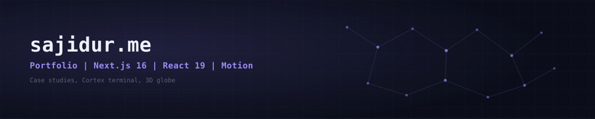
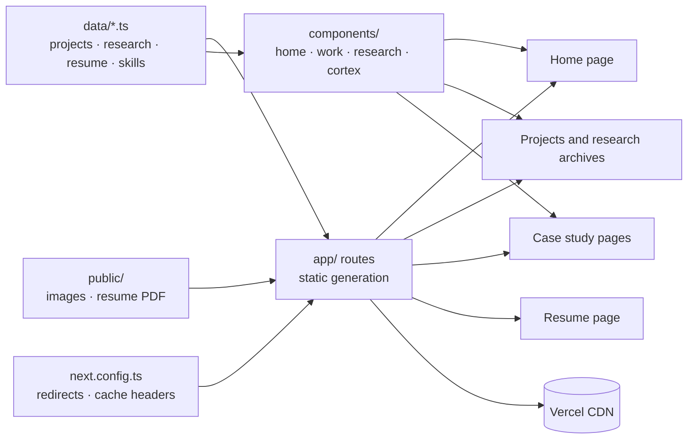

<div align="center">



<p><code>Personal portfolio of a Full-Stack Developer and AI engineer, built as a single fast Next.js site</code></p>

<a href="https://www.sajidur.me"></a>
<a href="https://github.com/Saji-d/portfolio"></a>
<a href="https://www.sajidur.me/resume"></a>

<p>


</p>

<a href="#-overview">Overview</a> ·
<a href="#-highlights">Highlights</a> ·
<a href="#-architecture">Architecture</a> ·
<a href="#-tech-stack">Tech Stack</a> ·
<a href="#-getting-started">Getting Started</a> ·
<a href="#-project-structure">Structure</a> ·
<a href="#-author">Author</a>

</div>


## ◈ Overview

This is the source of [sajidur.me](https://www.sajidur.me), the portfolio of Sajidur Rahman Sajid. It presents experience, projects, research and skills in one scrolling page, then goes deeper through searchable archives and full case studies.

The goal is a site that feels like an engineer built it: fast static pages, honest numbers, one coherent visual system and a few playful touches such as a terminal console and a 3D globe.


## ◈ Highlights

<table width="100%">
<tr>
<td width="33%" valign="top">

**Cortex terminal**
<br/>
A self-inspection console with commands such as `whoami`, `projects`, `skills` and `timeline`, plus a neural-network "synapse" view of the work.

</td>
<td width="33%" valign="top">

**Case studies**
<br/>
Deep write-ups for flagship projects: problem, solution, architecture, decisions and results, each with its own link preview image.

</td>
<td width="33%" valign="top">

**Searchable archives**
<br/>
Every project and research paper is filterable by discipline and searchable by title and stack, with tags that adapt to the card width.

</td>
</tr>
<tr>
<td width="33%" valign="top">

**3D globe**
<br/>
An interactive globe built on `react-globe.gl` and `three.js` that shows where the work reaches.

</td>
<td width="33%" valign="top">

**Resume page**
<br/>
A structured resume rendered from data and kept in sync with the downloadable PDF, which is always served uncached.

</td>
<td width="33%" valign="top">

**Command palette**
<br/>
Press <kbd>Ctrl</kbd> + <kbd>K</kbd> to jump to any section or project and to open links without touching the mouse.

</td>
</tr>
</table>


## ◈ Architecture

Everything is statically generated. Content lives in typed data files that pages and components read from. A project is added by editing data rather than markup.



- **Static first:** every route is prerendered. Heavy parts such as the globe and the Cortex console load lazily after the page is interactive.
- **Typed content:** project, research and resume data are TypeScript objects, so the compiler catches broken links and missing fields.
- **Cache rules:** the resume PDF is served with `no-store` so visitors never see an old copy. Static images are cached for a day with background refresh.


## ◈ Tech Stack

| Layer | Technologies | Purpose |
| :-- | :-- | :-- |
| Framework | Next.js 16 (App Router) · React 19 · TypeScript | Static pages with typed content |
| Styling | Tailwind CSS v4 · CSS design tokens | One visual system across every section |
| Motion | Motion · IntersectionObserver reveals | Scroll reveals and micro-interactions |
| 3D | react-globe.gl · three.js · world-atlas · topojson-client | The interactive globe |
| Images | next/image · sharp | Responsive covers and share previews |
| Tooling | ESLint · Vercel | Linting and zero-config deployment |


## ◈ Getting Started

**Prerequisites:** Node.js 20 or newer.

```bash
git clone https://github.com/Saji-d/portfolio.git
cd portfolio
npm install
npm run dev        # http://localhost:3000
```

```bash
npm run build      # production build
npm run start      # serve the production build
npm run lint       # ESLint
```

No environment variables are required.


## ◈ Project Structure

<details>
<summary>Open the folder map</summary>

```text
app/                 routes: home, projects, research, resume, about, contact
components/
  home/              hero, about, experience, projects, skills, cortex console
  work/              project cards, case study layout, stack tags
  research/          research overlay and showcase
  ui/                shared primitives such as Reveal, badges and tech icons
data/                typed content: projects, research, resume, skills, timeline
public/
  images/            covers, share previews and gallery images
  *.pdf              the current resume
scripts/             image optimisation helpers
```

</details>


## ◈ Author

**Sajidur Rahman Sajid**: Full-Stack Developer and AI engineer from Dhaka.<br>
BSc in CSE at American International University-Bangladesh (AIUB).

<p>
  <a href="https://www.sajidur.me"></a>
  <a href="https://www.linkedin.com/in/sajidur-rahman-sajid/"></a>
  <a href="https://github.com/Saji-d"></a>
  <a href="mailto:sajidsajidurrahman99@gmail.com"></a>
</p>

<sub>Released under the MIT License.</sub>
